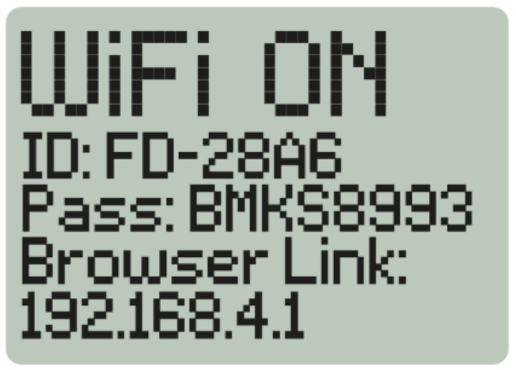
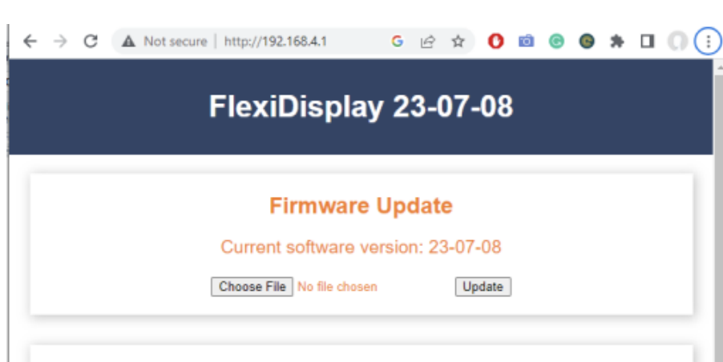
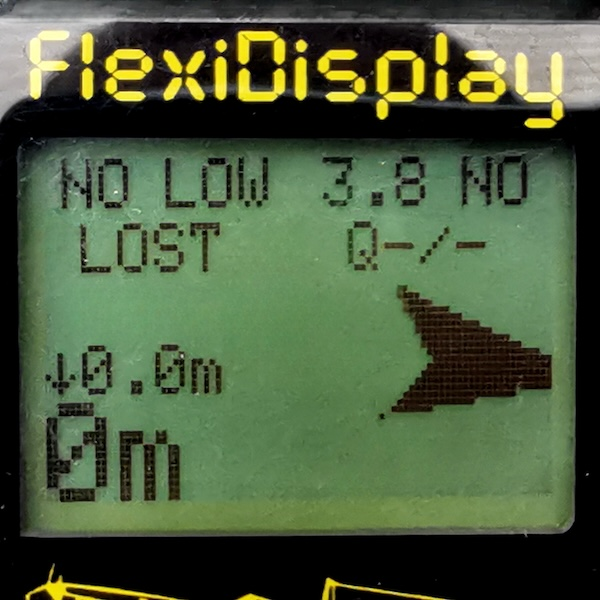
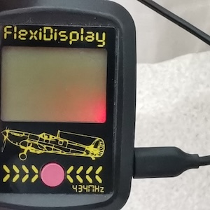
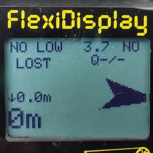
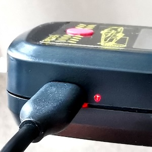

# FlexiDisplay Firmware Releases
Firmware for the original FlexiDisplay hand unit (ESP32).
For FlexiDisplay YELLO and SkyLink see [BMK_Firmware_Releases](https://github.com/melihkarakelle/BMK_Firmware_Releases).

## Latest firmware: v4.0

**One file for both screen types** (Nokia and ST7567). The firmware detects the screen by itself.

- [FlexiDisplay_v4.0_BLE.bin](https://github.com/melihkarakelle/FlexiDisplay-Firmware-Releases/raw/main/FlexiDisplay_v4.0_BLE.bin)

The same file is used for the Bluetooth update in the app and for the WiFi update in a web browser.

There are two ways to install it:

| Your FlexiDisplay has | Use |
|---|---|
| v3.0 or later | **Bluetooth** with the BMK FlyMate app (easiest), or WiFi |
| v2.0 or older | **WiFi** once (steps below). After that, Bluetooth works too. |

The firmware version is shown on the FlexiDisplay's info page.

## Update over Bluetooth (v3.0 and later)
1. Install **BMK FlyMate** (App Store / Google Play) and connect to your FlexiDisplay.
2. Hold the phone next to the FlexiDisplay (within 1–2 m).
3. Open **Device Update** and choose **FlexiDisplay v1.0 firmware v4.0 (Bluetooth)**.
4. When the FlexiDisplay shows **PRESS RED TO CONFIRM**, press its RED button.
5. The FlexiDisplay shows the progress and restarts by itself when the update is done.

## Update over WiFi (any version)

### 1. Download the firmware
Download [FlexiDisplay_v4.0_BLE.bin](https://github.com/melihkarakelle/FlexiDisplay-Firmware-Releases/raw/main/FlexiDisplay_v4.0_BLE.bin)
to your computer, phone or tablet.

### 2. Switch your FlexiDisplay to WiFi mode
- Firmware v2.0 and older: **Settings > WiFi**.
- Firmware v3.0 and later: **Menu > SYSTEM > WiFi**.

The screen shows **WiFi ON**, the network name (ID) and the password.

### 3. Connect to the FlexiDisplay
- Search for WiFi networks on your phone, tablet or computer. Look for the network named **FD-XXXX**.
- Connect with the password shown on the screen. It starts with **BMKS**.

### 4. Open the update page
Open a web browser and go to **[192.168.4.1](http://192.168.4.1)**.

### 5. Upload the firmware
- Choose the downloaded `FlexiDisplay_v4.0_BLE.bin` file.
- Press the upload button. The FlexiDisplay's screen shows the progress.
- The FlexiDisplay restarts by itself after the update. Do not switch it off during the update.

## Which FlexiDisplay do I have?
From v4.0 one file fits both screen types. The model only matters for the older v2.0 files further down.

### NOKIA DISPLAY
The legacy Nokia displays were used from day one until March 20, 2024.  
The red charging LED is part of the display backlight and is visible from the front.  
These displays have rubber contacts that need perfect alignment and are sensitive to impacts.  

### ST7567 DISPLAY
Used on FlexiDisplay mainboards since March 20, 2024.  
The red charging LED is not part of the display backlight. It sits next to the USB port.  
These displays have solderable contacts.  

# Version History

### v4.0
- One firmware for both screen types: the screen is detected automatically.
- Firmware updates over Bluetooth from the BMK FlyMate app, confirmed with the RED button. The WiFi update still works.
- New screens: QR page, flight list, boot logo, "◄ BACK" rows in the menus.
- New menus: RADIO, DEVICE, CALIBRATION and SYSTEM.
- Compass:
  - tilt compensation;
  - three-turn calibration (flat, upright, on its side);
  - the arrow also works with the unit held upright;
  - smoother round arrow;
  - ARROW ADJUST replaces magnetic deviation.
- FIND FD UNITS: shows the other FlexiDisplay / YELLO units nearby. They can also be found from the app.
- 2Way beacon setup, from the unit (2WAY BEACON menu) or from the app. FSK / LoRa radio mode in the device settings.
- GPS aiding from the phone, for a faster first fix.
- Step counter, with automatic GPS low-power mode while you walk (GPS AUTO LP).
- New settings:
  - BEACON NAME and BLE NAME editors;
  - SLEEP TIMER and BEEP TIMER;
  - ERASE FLIGHTS and FACTORY RESET.
- Boot check: an INIT ERROR screen appears if the compass, IMU, radio or memory is missing.
- Nokia screens: panel care at start-up and shutdown.
- Bluetooth output power raised to +3 dBm.

### v2.0
- Magnetic deviation calibration added to the settings.
- Compass arrow code updated.
- ST7567 display support added for the newer FlexiDisplays.

## Older files
These v2.0 files are kept for older app versions. Use them only to go back to v2.0. Pick the one that matches your screen.
- Nokia: [FlexiDisplay_Legacy_NOKIA_Display_v2.0.bin](https://github.com/melihkarakelle/FlexiDisplay-Firmware-Releases/raw/main/With_Legacy_Nokia_Display/FlexiDisplay_Legacy_NOKIA_Display_v2.0.bin)
- ST7567: [FlexiDisplay_ST7567_Display_v2.0.bin](https://github.com/melihkarakelle/FlexiDisplay-Firmware-Releases/raw/main/With_ST7567_Display/FlexiDisplay_ST7567_Display_v2.0.bin)
- The `*_Latest_Firmware.bin` files in the two folders are also v2.0. Older app versions download them under that name.
